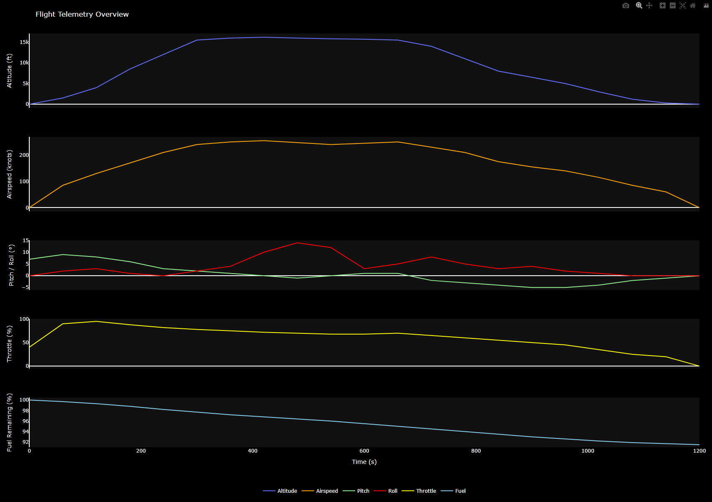
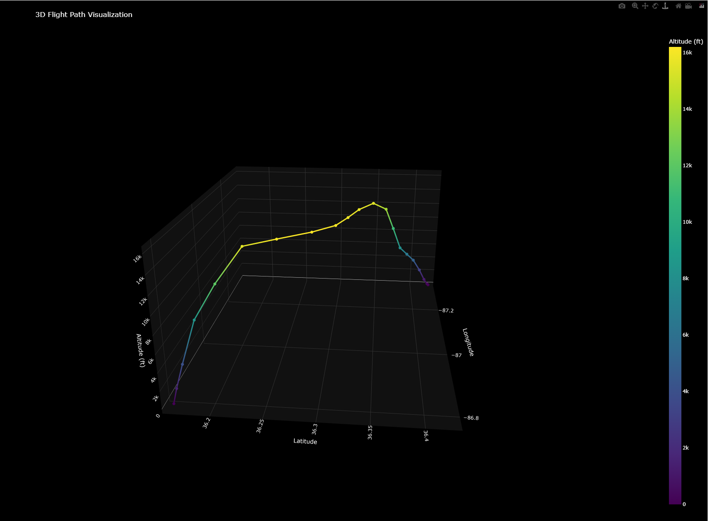

# Flight Path Analyzer

This project provides a 3D flight path and telemetry visualization for a simulated aircraft flight.
The charts display the aircraft’s altitude, airspeed, pitch, roll, throttle, and fuel throughout the flight,along with an interactive 3D map showing its route from takeoff to landing.

## Features

- **3D Flight Path**: Visualizes the aircraft’s trajectory in three dimensions.
- **Altitude & Airspeed**: Shows climb, cruise, and descent profiles.
- **Pitch / Roll**: Displays the aircraft’s flight attitude and bank angles.
- **Throttle**: Represents power usage throughout the flight.
- **Fuel Remaining**: Tracks consumption over time.

## Installation

To install the necessary dependencies, run:git

```bash
pip install -r requirements.txt
```

## Usage

To generate the lap trace plot, run the following command:

```bash
python analyze_flight.py
```

## Example


